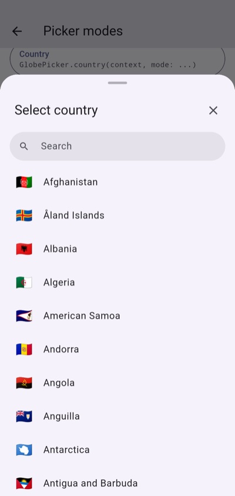
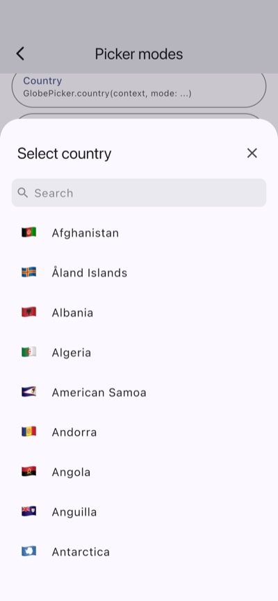
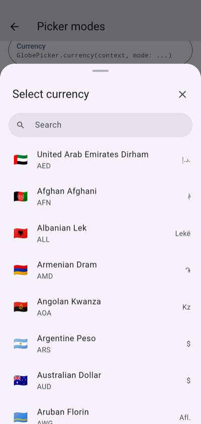
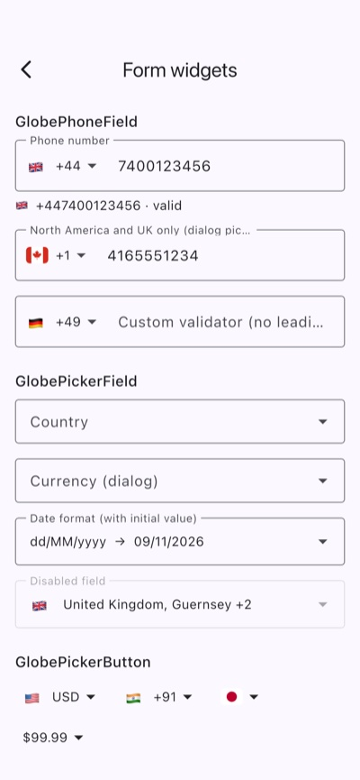
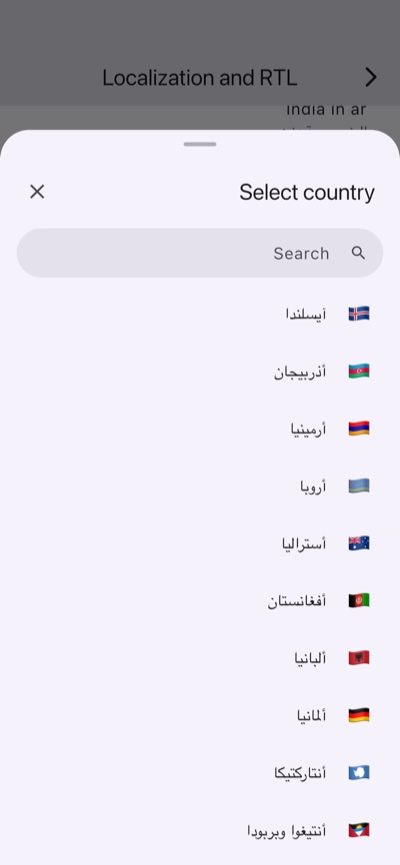
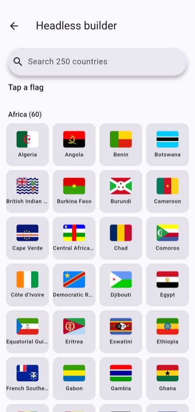

# flutter_globe_picker 🌍

> **All-in-one world data and pickers for Flutter.**
> Countries, currencies, dial codes, date formats and flags, linked together,
> with fully customizable pickers, search, filters and a phone field.

[](https://pub.dev/packages/flutter_globe_picker)
[](https://pub.dev/packages/flutter_globe_picker/score)
[](https://pub.dev/packages/flutter_globe_picker/score)
[](LICENSE)

<table>
  <tr>
    <th>Country picker (Android)</th>
    <th>iOS style sheet (iOS)</th>
    <th>Currency picker (Android)</th>
  </tr>
  <tr>
    <td></td>
    <td></td>
    <td></td>
  </tr>
  <tr>
    <th>Phone field (iOS)</th>
    <th>Arabic, right to left (iOS)</th>
    <th>Headless grid (Android)</th>
  </tr>
  <tr>
    <td></td>
    <td></td>
    <td></td>
  </tr>
</table>

- **One package** instead of a country picker, a currency picker, a dial code picker, a flag package and a phone field.
- **Linked models**: pick a currency and read its countries and flags; pick a country and read its currency, dial code, date format and number format.
- **One filter** for every picker type.
- **Three levels of UI**: ready-made pickers, building blocks, or fully headless.
- **Fully customizable**: theme, texts, visible parts, and a builder for every part.
- **Offline, readable JSON**: all data ships in the package as one data file and one translations file, with no network calls. Pickers load them by themselves; change any value or bring your own copies at runtime.
- **No extra packages for you to add**: the only dependency is `flutter_svg` (for SVG flags), which installs automatically.

| Data | Count | Source |
|---|---|---|
| Countries and territories | 250 (ISO 3166-1 + Kosovo) | Unicode CLDR |
| Currencies in use | 153 (ISO 4217) | Unicode CLDR |
| Dial codes | 232 | Google libphonenumber |
| Date formats | 11 | Unicode CLDR |
| Name translations | 29 languages + English | Unicode CLDR |
| SVG flags | 4:3 and 1:1 | flag-icons |

---

## Contents

- [Installation](#installation)
- [Quick start](#quick-start)
- [Three ways to use it](#three-ways-to-use-it)
- [Linked models](#linked-models)
- [One filter for everything](#one-filter-for-everything)
- [What each row shows](#what-each-row-shows)
- [Search](#search)
- [Customize the UI](#customize-the-ui)
- [Favorites, recents, grouping, multi-select](#favorites-recents-grouping-multi-select)
- [Phone number field](#phone-number-field)
- [Form field and button](#form-field-and-button)
- [Controller](#controller)
- [Headless API](#headless-api)
- [Flags](#flags)
- [Localization, RTL and accessibility](#localization-rtl-and-accessibility)
- [Platform support](#platform-support)
- [Data](#data)
- [Migrating from other packages](#migrating-from-other-packages)
- [Roadmap](#roadmap)

---

## Installation

```yaml
dependencies:
  flutter_globe_picker: ^0.1.2
```

```dart
import 'package:flutter_globe_picker/flutter_globe_picker.dart';
```

Requires Dart 3.13.7 and Flutter 3.47.8 or newer.

---

## Quick start

```dart
final country  = await GlobePicker.country(context);     // GlobeCountry?
final currency = await GlobePicker.currency(context);    // GlobeCurrency?
final dialCode = await GlobePicker.dialCode(context);    // GlobeDialCode?
final format   = await GlobePicker.dateFormat(context);  // GlobeDateFormat?
```

Every picker returns `null` when it is closed without a selection.

Pickers, fields and buttons load the bundled data by themselves the first time they need it. If your own code reads `GlobeData` directly, load it once before `runApp`:

```dart
Future<void> main() async {
  WidgetsFlutterBinding.ensureInitialized();
  await GlobeData.load();
  runApp(const MyApp());
}
```

Choose how it opens:

```dart
GlobePicker.currency(context); // bottom sheet (default)
GlobePicker.currency(context, mode: GlobePickerMode.dialog);
GlobePicker.currency(context, mode: GlobePickerMode.fullPage);
GlobePicker.currency(context, mode: GlobePickerMode.cupertinoSheet);
```

Or use one generic method. The result type follows the picker type:

```dart
final GlobeCurrency? currency = await GlobePicker.show(
  context,
  type: GlobePickerType.currency,
);
```

---

## Three ways to use it

### 1. Ready-made UI

`GlobePicker` opens a complete picker (title, search bar, list) as a bottom sheet, dialog, full page or Cupertino sheet. See [Quick start](#quick-start).

### 2. Building blocks

Embed the same picker anywhere, for example inside your own screen, sheet or dialog:

```dart
GlobePickerView(
  type: GlobePickerType.country,
  onSelected: (country) => setState(() => selected = country),
)
```

`GlobePickerView` fills the space it gets, so give it a bounded height (for example inside `Expanded` or a `SizedBox`).

The pieces are public too: `GlobeSearchBar`, `GlobeListTile`, `GlobeFlag`, `GlobePickerButton` and `GlobePickerController`.

### 3. Headless

`GlobePickerBuilder` does the filtering, sorting, searching, grouping and selection, and you draw everything:

```dart
GlobePickerBuilder(
  type: GlobePickerType.country,
  onSelected: (country) => print(country.name),
  builder: (context, snapshot) => Column(
    children: [
      TextField(onChanged: snapshot.search),
      Expanded(
        child: GridView.count(
          crossAxisCount: 4,
          children: [
            for (final country in snapshot.items)
              InkWell(
                onTap: () => snapshot.onItemTap(country),
                child: GlobeFlag.fromItem(country, type: GlobeFlagType.svg),
              ),
          ],
        ),
      ),
    ],
  ),
)
```

The snapshot gives you `items`, `sections`, `query`, `selection`, `isSelected()`, `search()`, `onItemTap()`, `confirm()` and `close()`.

Or skip the widgets entirely and use [`GlobeData`](#headless-api).

---

## Linked models

Every model can reach every other model. All four are subtypes of the sealed class `GlobeItem`, so a `switch` over them is checked by the compiler.

### `GlobeCountry`

```dart
final india = GlobeData.countryByAlpha2('IN')!;

india.name;               // India
india.localizedName(const Locale('hi')); // भारत
india.alpha2Code;         // IN
india.alpha3Code;         // IND
india.numCode;            // 356
india.flagEmoji;          // 🇮🇳
india.capital;            // New Delhi
india.region;             // GlobeRegion.asia
india.subregion;          // Southern Asia
india.languages;          // [hi, en]
india.timezones;          // [Asia/Kolkata]
india.tld;                // .in

india.dialCode;           // +91
india.callingCode;        // +91
india.dialCodeInfo;       // GlobeDialCode

india.currency;           // GlobeCurrency? (null only for Antarctica)
india.currencies;         // every currency in use (Panama: PAB, USD)

india.dateFormat;         // GlobeDateFormat(dd/MM/yyyy)
india.numberFormat;       // separators and grouping: 12,34,567.50

india.phoneLengths;       // [10]
india.phoneExample;       // 8123456789
india.isValidPhoneNumber('98765 43210'); // true

india.isEUMember;         // false
india.isEurozone;         // false
india.isUNMember;         // true
```

### `GlobeCurrency`

```dart
final euro = GlobeData.currencyByCode('EUR')!;

euro.code;             // EUR
euro.name;             // Euro
euro.symbol;           // €
euro.nativeSymbol;     // €   (AED: د.إ.)
euro.numCode;          // 978
euro.decimalDigits;    // 2   (JPY: 0, KWD: 3)
euro.countries;        // every country using the euro
euro.primaryCountry;   // null for shared currencies (INR → India)

euro.format(1234.5);                                          // €1,234.50
euro.format(1234.5, country: GlobeData.countryByAlpha2('DE')); // 1.234,50 €
GlobeData.currencyByCode('INR')!.format(1234567.5);           // ₹12,34,567.50
```

### `GlobeDialCode`

```dart
final plusOne = GlobeData.dialCodeByCode('+1')!;
plusOne.countries;   // United States, Canada
plusOne.country;     // United States (main country)

GlobeData.countryByAlpha2('JM')!.dialCode; // +1876 (area code included)
```

### `GlobeDateFormat`

```dart
final usFormat = GlobeData.countryByAlpha2('US')!.dateFormat;
usFormat.pattern;                       // MM/dd/yyyy
usFormat.format(DateTime(2026, 11, 8)); // 11/08/2026
usFormat.countries;                     // countries writing dates this way
```

### Relationship map

```
             currencies          countries
  GlobeCountry ──────────▶ GlobeCurrency ──────────▶ GlobeCountry
       │
       ├── dialCodeInfo ──▶ GlobeDialCode ── countries ──▶ GlobeCountry
       │
       └── dateFormat ───▶ GlobeDateFormat ─ countries ──▶ GlobeCountry
```

---

## One filter for everything

`GlobeFilter` works with every picker type and with headless lists.

```dart
const appFilter = GlobeFilter(
  excludeCountries: ['AQ', 'BV', 'HM'],
  excludeCurrencies: ['XOF'],
  regions: [GlobeRegion.asia, GlobeRegion.europe],
);

GlobePicker.country(context, filter: appFilter);
GlobePicker.currency(context, filter: appFilter);
GlobePicker.dialCode(context, filter: appFilter);
```

| Option | Type | Applies to |
|---|---|---|
| `countries` / `excludeCountries` | `List<String>` (alpha-2) | every type |
| `regions` / `excludeRegions` | `List<GlobeRegion>` | every type |
| `where` | `bool Function(GlobeCountry)` | every type |
| `currencies` / `excludeCurrencies` | `List<String>` (ISO 4217) | currency picker |
| `dialCodes` / `excludeDialCodes` | `List<String>` (`+91` or `91`) | dial code picker |

**How it works:** country rules apply to every type. An item is kept when at least one of its countries passes them, so excluding a country also hides a dial code that only it uses. Currency and dial code rules only filter their own picker, so one shared filter can hide a currency without hiding the countries that use it. Codes are case-insensitive.

Presets:

```dart
GlobeFilter.europeanUnion; // 27 EU members
GlobeFilter.eurozone;      // 21 euro countries
GlobeFilter.unMembers;     // 193 UN members
```

Combine and modify:

```dart
final asianOnly = appFilter.copyWith(regions: [GlobeRegion.asia]);
final both = appFilter + GlobeFilter(where: (country) => country.isUNMember); // must pass both
```

Use it without UI:

```dart
final countries = appFilter.apply(GlobeData.countries);
final keep = appFilter.matches(someItem);
```

---

## What each row shows

```dart
GlobePicker.country(
  context,
  display: const GlobeDisplay(
    fields: [GlobeField.flag, GlobeField.countryName, GlobeField.capital],
    trailingFields: [GlobeField.dialCode],
    flagType: GlobeFlagType.svg,
    flagShape: GlobeFlagShape.circle,
  ),
);
```

The first text field is the title, the other text fields form the subtitle, and `trailingFields` appear at the end of the row. Every field works with every picker type.

| `GlobeField` | Shows |
|---|---|
| `flag` | emoji or SVG flag |
| `countryName` | country name |
| `alpha2Code` / `alpha3Code` / `numCode` | ISO codes |
| `dialCode` | dial code |
| `currencyName` / `currencyCode` / `currencySymbol` | currency |
| `dateFormat` / `dateExample` | date pattern / today's date in that pattern |
| `region` / `capital` | region / capital city |

`GlobeDisplay` also controls which parts are visible: `showTitle`, `showCloseButton`, `showDragHandle`, `showDividers`, `showSelectedIndicator` and `showSectionHeaders`.

---

## Search

Search ignores case, accents and punctuation. `cote d iv` finds "Côte d'Ivoire", `91` finds `+91` and aliases such as "Ivory Coast" match too. Exact matches come first, then prefixes, then other matches.

```dart
GlobePicker.country(
  context,
  search: const GlobeSearchConfig(
    hint: 'Search country or code',
    fields: [GlobeField.countryName, GlobeField.alpha2Code, GlobeField.dialCode],
    autoFocus: true,
    minChars: 1,
    debounce: Duration(milliseconds: 200),
  ),
);
```

Set `enabled: false` to hide the search bar.

---

## Customize the UI

Five levels, from small tweaks to a full redesign.

### 1. Theme

Every value is optional. Defaults come from your `ColorScheme` and `TextTheme`, so the pickers match light and dark mode with no setup.

```dart
GlobePicker.country(
  context,
  theme: const GlobePickerTheme(
    backgroundColor: Colors.white,
    borderRadius: 20,
    heightFactor: 0.9,
    titleStyle: TextStyle(fontSize: 20, fontWeight: FontWeight.bold),
    itemTitleStyle: TextStyle(fontSize: 16),
    selectedTileColor: Color(0x1A2196F3),
    flagWidth: 28,
    flagHeight: 20,
  ),
);
```

Set it once for the whole app:

```dart
MaterialApp(
  theme: ThemeData(
    extensions: const [GlobePickerTheme(borderRadius: 24)],
  ),
);
```

### 2. Texts

```dart
const spanish = GlobeStrings(
  countryTitle: 'Selecciona un país',
  searchHint: 'Buscar',
  noResults: 'Sin resultados',
  done: 'Listo',
);
GlobePicker.country(context, strings: spanish);
```

### 3. Show or hide parts

```dart
display: const GlobeDisplay(
  showTitle: false,
  showDividers: true,
  showSelectedIndicator: false,
),
search: const GlobeSearchConfig(enabled: false),
```

### 4. Builders for each part

Replace any part and keep the rest:

```dart
GlobePicker.currency(
  context,
  builders: GlobePickerBuilders(
    itemBuilder: (context, currency, isSelected, onTap) => ListTile(
      leading: GlobeFlag.fromItem(currency, shape: GlobeFlagShape.circle),
      title: Text('${currency.name} (${currency.symbol})'),
      subtitle: Text(currency.format(1234.5)),
      selected: isSelected,
      onTap: onTap,
    ),
    headerBuilder: (context, snapshot) => const Text('Pick a currency'),
    searchBarBuilder: (context, textController, onChanged) =>
        TextField(controller: textController, onChanged: onChanged),
    sectionHeaderBuilder: (context, title) => Text(title),
    separatorBuilder: (context) => const Divider(),
    emptyBuilder: (context, query) => Text('Nothing for "$query"'),
    flagBuilder: (context, currency) => GlobeFlag.fromItem(currency),
    selectedIndicatorBuilder: (context, isSelected) => const Icon(Icons.done),
    footerBuilder: (context, snapshot) => Text('${snapshot.items.length} currencies'),
    containerBuilder: (context, child) => Padding(padding: const EdgeInsets.all(8), child: child),
  ),
);
```

With generic widgets such as `GlobePickerView`, name the item type so the builder callbacks are typed: `GlobePickerView<GlobeCurrency>(builders: GlobePickerBuilders(...))`.

### 5. Build it all yourself

Use [`GlobePickerBuilder`](#3-headless) and draw everything from the snapshot.

### Reuse options

`GlobePickerOptions` bundles filter, display, search, grouping, favorites, title, theme and texts so you can share them between pickers and widgets:

```dart
const options = GlobePickerOptions(
  filter: GlobeFilter(excludeCountries: ['AQ']),
  groupBy: GlobeGroupBy.alphabet,
  favorites: ['IN', 'US'],
);

GlobePicker.show(context, type: GlobePickerType.country, options: options);
GlobePickerView(type: GlobePickerType.country, options: options);
```

---

## Favorites, recents, grouping, multi-select

```dart
GlobePicker.country(
  context,
  favorites: const ['IN', 'US', 'GB'], // pinned on top
  selected: 'IN',                      // preselected
  showRecents: true,                   // recently picked on top
  groupBy: GlobeGroupBy.alphabet,      // or GlobeGroupBy.region
);
```

Multi-select returns a list, or `null` when closed without confirming:

```dart
final countries = await GlobePicker.countries(context, selected: const ['IN']);
final currencies = await GlobePicker.currencies(context);
final items = await GlobePicker.showMultiple(context, type: GlobePickerType.dialCode);
```

Recents are kept in memory for the app session. To keep them across launches, save and restore them with your own storage:

```dart
GlobeRecents.instance.restore(GlobePickerType.country, savedIds);
GlobeRecents.instance.addListener(() {
  save(GlobeRecents.instance.idsFor(GlobePickerType.country));
});
```

---

## Phone number field

```dart
GlobePhoneField(
  initialCountryCode: 'IN',        // otherwise from the device locale
  isRequired: true,
  onChanged: (phone) {
    phone.e164;      // +919876543210
    phone.isValid;   // checked against the country's numbering plan
    phone.country;   // GlobeCountry
  },
)
```

- The country button opens a searchable country picker with dial codes.
- Typing or pasting `+44 7400 123456`, `0044…` or the country's own international prefix (`011…` in the US) switches the country automatically, also when the text is set on the `controller` or by autofill. For calling codes shared by several countries (`+1`, `+44`, `+7`) the field waits for the area code before choosing.
- Pasted numbers are cleaned: invisible direction marks, full-width `＋`, non-Latin digits (Arabic, Devanagari...) and extensions (`ext. 12`) are handled.
- Validation follows libphonenumber's numbering plans: lengths, the general pattern and every number type (mobile, fixed line, toll free...).
- A leading trunk prefix is accepted (`07400 123456` in the UK becomes `+447400123456`).
- `Form.reset()` brings back the starting country and number.
- It works inside `Form`, with `validator`, `onSaved` and `autovalidateMode`.
- The hint shows an example number for the selected country.

---

## Form field and button

```dart
GlobePickerField(
  type: GlobePickerType.currency,
  decoration: const InputDecoration(labelText: 'Currency'),
  validator: (currency) => currency == null ? 'Select a currency' : null,
  onChanged: (currency) => print(currency?.code),
  showClearButton: true,
)

GlobePickerButton(
  type: GlobePickerType.currency,
  value: currency,
  onChanged: (value) => setState(() => currency = value),
)
```

---

## Controller

```dart
final controller = GlobePickerController<GlobeCountry>();

GlobePickerView(type: GlobePickerType.country, controller: controller);

controller.search('ind');
controller.select(GlobeData.countryByAlpha2('IN')!);
controller.toggle(GlobeData.countryByAlpha2('US')!);
controller.clearSelection();
controller.selected;   // first selected item
controller.selection;  // all selected items
```

Dispose the controller when you no longer need it.

---

## Headless API

Building your own UI? Use `GlobeData` and the models below with the same import. Widgets you do not use are left out of your app's release build, so there is nothing extra to pay for.

Every model converts to and from JSON with the keys used in [`assets/globe_data.json`](assets/globe_data.json), so you can store it, send it to your backend or load your own data:

```dart
final json = GlobeData.countryByAlpha2('IN')!.toJson();
final country = GlobeCountry.fromJson(json);
final currency = GlobeCurrency.fromJson({'code': 'INR', 'name': 'Indian Rupee', 'symbol': '₹'});
```

```dart
// Collections (sorted, unmodifiable)
GlobeData.countries;
GlobeData.currencies;
GlobeData.dialCodes;
GlobeData.dateFormats;

// Lookups
GlobeData.countryByAlpha2('IN');
GlobeData.countryByAlpha3('IND');
GlobeData.countryByNumCode(356);
GlobeData.countryByCode('IND');            // alpha-2, alpha-3 or numeric
GlobeData.countryByName('Ivory Coast');
GlobeData.countriesByRegion(GlobeRegion.europe);
GlobeData.countriesByDialCode('+1');       // every NANP country
GlobeData.dialCodeByCode('+44');
GlobeData.currencyByCode('INR');
GlobeData.currenciesBySymbol(r'$');
GlobeData.dateFormatByPattern('dd/MM/yyyy');

// The user's country and currency
GlobeData.countryFromLocale(Localizations.localeOf(context));
GlobeData.currencyFromLocale(Localizations.localeOf(context));

// Search
GlobeData.searchCountries('ind');
GlobeData.searchCurrencies('dollar');
GlobeData.searchDialCodes('44');
GlobeData.search('eur'); // countries and currencies

// Phone numbers
GlobeData.parsePhone('+1 416 555 1234');   // Canada, resolved by area code
GlobeData.parsePhone('98765 43210', defaultCountry: india);

// Formatting
GlobeData.formatDate(date, countryCode: 'US');            // 11/08/2026
GlobeData.formatDate(date, pattern: 'EEE, d MMM yyyy');    // Sun, 8 Nov 2026
GlobeData.formatDateTime(date, countryCode: 'US', use24Hour: false); // 11/08/2026 02:05 PM
GlobeData.formatCurrency(1234.5, currencyCode: 'EUR', countryCode: 'FR'); // 1 234,50 €
```

Month and weekday names are English by default. Pass `symbols: GlobeDateSymbols(...)` to use another language.

---

## Flags

```dart
GlobeFlag(code: 'IN');                                    // emoji or SVG (auto)
GlobeFlag(code: 'IN', type: GlobeFlagType.svg, width: 40);
GlobeFlag(code: 'IN', shape: GlobeFlagShape.circle);
GlobeFlag.fromItem(GlobeData.currencyByCode('EUR')!);     // EU flag
GlobeFlag.fromItem(dialCode);                             // main country's flag

country.flagEmoji;        // 🇮🇳
country.flagAssetPath();  // assets/flags/4x3/in.svg (package: flutter_globe_picker)
```

`GlobeFlagType.auto` (the default) uses emoji on Android, iOS, macOS and the web, and SVG on Windows and Linux, where flag emoji show as letters.

SVG flags come from [flag-icons](https://github.com/lipis/flag-icons) (MIT) in 4:3 and 1:1 shapes. They add about 4.6 MB of uncompressed assets to your app (much less once compressed).

---

## Localization, RTL and accessibility

- Country and currency names are translated into 29 languages besides English: Arabic, Bengali, Chinese (Simplified and Traditional), Dutch, French, German, Gujarati, Hebrew, Hindi, Indonesian, Italian, Japanese, Korean, Malay, Marathi, Persian, Polish, Portuguese, Russian, Spanish, Swedish, Tamil, Telugu, Thai, Turkish, Ukrainian, Urdu and Vietnamese. Missing names fall back to English.
- Pickers follow `Localizations.localeOf(context)`: they show, sort and group by the translated names, and search matches both the translated and the English name. Turn this off with `GlobeDisplay(useLocalizedNames: false)`.
- In your own code: `country.localizedName(locale)`, `currency.localizedName(locale)`, and `GlobeData.searchCountries(query, locale: locale)`.
- Fix or add a translation with `translationOverrides`, or bring your own translations file (see [Change the data](#change-the-data)).
- All picker texts can be translated with `GlobeStrings`.
- Layouts use directional padding and work in right-to-left languages.
- Flags have semantic labels ("Flag of India"), section headers are marked as headers, and text scales with the system font size.

---

## Platform support

| Android | iOS | Web | macOS | Windows | Linux |
|:---:|:---:|:---:|:---:|:---:|:---:|
| ✅ | ✅ | ✅ | ✅ | ✅ | ✅ |

The package is pure Dart and Flutter with no platform code.

---

## Data

All data ships in the package as two readable JSON files in [`assets/`](assets/):

| File | Contents | Size |
|---|---|---|
| [`globe_data.json`](assets/globe_data.json) | every country and every currency, in English | ~390 KB |
| [`globe_translations.json`](assets/globe_translations.json) | country and currency names in 29 languages, linked to the data by code | ~420 KB |

### `globe_data.json`

The full structure, shown with India and its currency (the real entries; only the long `phoneTypesPattern` is cut here):

```json
{
  "sources": {
    "cldr": "49.0.0",
    "libphonenumber": "v9.0.43",
    "tz": "2026f",
    "flagIcons": "7.6.0"
  },
  "countries": [
    {
      "name": "India",
      "aliases": [],
      "alpha2Code": "IN",
      "alpha3Code": "IND",
      "flagEmoji": "🇮🇳",
      "flag": "assets/flags/4x3/in.svg",
      "flagSquare": "assets/flags/1x1/in.svg",
      "numCode": "356",
      "capital": "New Delhi",
      "region": "asia",
      "subregion": "Southern Asia",
      "dialCodes": ["+91"],
      "currencyCodes": ["INR"],
      "languages": ["hi", "en"],
      "timezones": ["Asia/Kolkata"],
      "tld": ".in",
      "dateFormat": "dd/MM/yyyy",
      "decimalSeparator": ".",
      "groupSeparator": ",",
      "currencyPattern": "¤#,##,##0.00",
      "formatLocale": "hi",
      "phoneLengths": [8, 9, 10, 11, 12, 13],
      "phoneExample": "8123456789",
      "nationalPrefix": "0",
      "phoneInternationalPrefix": "00",
      "phonePattern": "(?:000800|[2-9]\\d\\d)\\d{7}|1\\d{7,12}",
      "phoneLeadingDigits": null,
      "phoneTypesPattern": "(?:186[12]\\d{9})|(?:000800\\d{7}|180(?:0\\d{4,9}|3\\d{9}))|…",
      "isMainCountryForDialCode": true,
      "isEUMember": false,
      "isEurozone": false,
      "isUNMember": true
    }
  ],
  "currencies": [
    {
      "code": "INR",
      "name": "Indian Rupee",
      "symbol": "₹",
      "nativeSymbol": "₹",
      "numCode": "356",
      "decimalDigits": 2
    }
  ],
  "languageCountries": {
    "hi": "IN",
    "ja": "JP",
    "fr": "FR"
  }
}
```

| Key | Meaning |
|---|---|
| `sources` | versions of the sources the file was built from |
| `countries` | 250 countries and territories (ISO 3166-1 plus Kosovo), sorted by alpha-2 code |
| `currencies` | 153 currencies in use (ISO 4217), sorted by code |
| `languageCountries` | the main country of each language code, used by `GlobeData.countryFromLocale` when a locale has no country (`ja` → Japan) |

Country fields, also the keys of `GlobeCountry.toJson()`:

| Field | Type | Meaning |
|---|---|---|
| `name` | string | English name |
| `aliases` | list | other English names for search, such as "Ivory Coast" |
| `alpha2Code`, `alpha3Code` | string | ISO 3166-1 codes |
| `numCode` | string? | ISO 3166-1 numeric code, `null` for Kosovo |
| `flagEmoji`, `flag`, `flagSquare` | string | emoji flag and bundled SVG paths (4:3 and 1:1); derived from the code, not read back |
| `capital` | string? | capital city |
| `region`, `subregion` | string | `africa`, `americas`, `antarctica`, `asia`, `europe` or `oceania`, and the UN M.49 subregion |
| `dialCodes` | list | dial codes; North American countries include the area code (`+1876`) |
| `currencyCodes` | list | currencies in use, main one first |
| `languages` | list | official languages (BCP 47) |
| `timezones` | list | IANA time zones |
| `tld` | string? | internet domain |
| `dateFormat` | string | usual numeric date pattern |
| `decimalSeparator`, `groupSeparator`, `currencyPattern` | string | number and currency formatting |
| `formatLocale` | string | CLDR locale the formats came from (for reference, not read back) |
| `phoneLengths` | list | possible lengths of a national number, every number type |
| `phoneExample` | string? | an example number of this country, without trunk prefix |
| `nationalPrefix`, `phoneInternationalPrefix` | string? | trunk prefix (`0`) and the pattern of the prefix dialled to call abroad (`00`, `011`) |
| `phonePattern` | string? | general pattern of a national number |
| `phoneTypesPattern` | string? | patterns of every number type combined; a valid number matches one |
| `phoneLeadingDigits` | string? | first digits that tell apart countries sharing a dial code (Kazakhstan in `+7`) |
| `isMainCountryForDialCode` | bool | the only or main country of its dial code |
| `isEUMember`, `isEurozone`, `isUNMember` | bool | memberships |

Currency fields, also the keys of `GlobeCurrency.toJson()`: `code`, `name` (English), `symbol`, `nativeSymbol` (as written in the issuing country), `numCode` and `decimalDigits`.

### `globe_translations.json`

Names only, grouped by language, then `countries` (by alpha-2 code) and `currencies` (by currency code). Shown here for India and the rupee in three languages; the file has every country and every currency in each of its 29 languages: `ar`, `bn`, `de`, `es`, `fa`, `fr`, `gu`, `he`, `hi`, `id`, `it`, `ja`, `ko`, `mr`, `ms`, `nl`, `pl`, `pt`, `ru`, `sv`, `ta`, `te`, `th`, `tr`, `uk`, `ur`, `vi`, `zh`, `zh-Hant`.

```json
{
  "fr": {
    "countries": {
      "IN": "Inde"
    },
    "currencies": {
      "INR": "roupie indienne"
    }
  },
  "hi": {
    "countries": {
      "IN": "भारत"
    },
    "currencies": {
      "INR": "भारतीय रुपया"
    }
  },
  "ja": {
    "countries": {
      "IN": "インド"
    },
    "currencies": {
      "INR": "インド ルピー"
    }
  }
}
```

A name missing for a language falls back to the English `name` in `globe_data.json`.

### Sources

The files were built from the sources below and are maintained by hand from there; tests check every change.

| Data | Source | License |
|---|---|---|
| Country names, codes, regions, currencies, symbols, date and number formats, translations | [Unicode CLDR](https://cldr.unicode.org) 49 | Unicode License v3 |
| Dial codes, phone lengths, patterns and examples | [Google libphonenumber](https://github.com/google/libphonenumber) 9.0.43 | Apache 2.0 |
| Time zones | [IANA tz database](https://www.iana.org/time-zones) 2026f | Public domain |
| SVG flags and capitals | [flag-icons](https://github.com/lipis/flag-icons) 7.6.0 | MIT |

### Good to know

- **Empty values are expected.** Uninhabited territories (Antarctica, Bouvet Island, Heard Island) have no capital, languages or time zones. Kosovo has no ISO numeric code or domain. Seven territories without their own phone numbering (AQ, BV, GS, HM, PN, TF, UM) have no phone data; their numbers are checked with the main country of their calling code (Norway for Bouvet Island, the US for the US Minor Outlying Islands).
- **`phoneLeadingDigits` is usually `null`.** It is only needed to tell apart countries sharing a dial code, such as Kazakhstan inside `+7`.
- **Phone numbers match libphonenumber 9.0.43** for 99.9% of a 6,700-number comparison. The differences: Saint Martin and Western Sahara share every number range with Guadeloupe and Morocco, so their numbers are detected as those countries (as in libphonenumber); Ascension (`+247`) and Tristan da Cunha numbers are not recognized; and a few national rewriting rules are not applied (Belarus `8 0…`, Argentina `15`, a leading `0` after `+241` in Gabon, short Norfolk Island numbers).
- **`decimalDigits` follows CLDR**, which reflects everyday use: COP, HUF and IDR use 0 digits although ISO 4217 lists 2.

### Change the data

Change any value at runtime, before it is used. Keys are alpha-2 or currency codes; values hold the fields to replace, with the JSON keys above. A code that does not exist yet adds a new entry (with every required field).

```dart
await GlobeData.load(
  countryOverrides: {
    'IN': {'name': 'Bharat', 'aliases': ['India']},
  },
  currencyOverrides: {
    'INR': {'symbol': 'Rs'},
  },
  translationOverrides: {
    'hi': {'countries': {'IN': 'भारत गणराज्य'}},
  },
  languages: ['hi', 'fr'], // keep only these translations in memory; [] for English only
);
```

Or give the same settings, your own copies of the files, or JSON text from your server to any widget with a `GlobeDataSource`. Widgets without one use the data already loaded, or load the bundled data:

```dart
// Your updated copies, declared in your pubspec.
const myData = GlobeDataSource(
  assetKey: 'assets/my_globe_data.json',
  translationsAssetKey: 'assets/my_globe_translations.json',
);

GlobePicker.country(context, dataSource: myData);
GlobePickerView(type: GlobePickerType.country, options: const GlobePickerOptions(dataSource: myData));
GlobePhoneField(pickerOptions: const GlobePickerOptions(dataSource: myData));

// JSON text you downloaded.
GlobeData.loadFromJson(dataJson, translationsJson: translationsJson);
```

- The app has one data set: loading a source replaces it everywhere, and every picker, lookup and phone parser uses it.
- Keep `alpha2Code` (or a currency's `code`) unchanged: links between countries, currencies, dial codes and translations use it.
- A country you add without translations shows its English name.
- To hide items, use a [`GlobeFilter`](#one-filter-for-everything) instead of changing the data.
- `copyWith` changes a single model, for example to pass a custom list to a picker with `items`.
- In your own widgets that read `GlobeData` before it may be loaded, wrap them in `GlobeDataLoader`.

Found a mistake? Please open an issue with a source link. See [CONTRIBUTING.md](CONTRIBUTING.md).

---

## Migrating from other packages

| From | To |
|---|---|
| `showCountryPicker(context: context, onSelect: ...)` (country_picker) | `final country = await GlobePicker.country(context);` |
| `showCurrencyPicker(context: context, onSelect: ...)` (currency_picker) | `final currency = await GlobePicker.currency(context);` |
| `CountryCodePicker(...)` (country_code_picker) | `GlobePickerButton(type: GlobePickerType.dialCode, ...)` or `GlobePhoneField(...)` |
| `country.phoneCode` | `country.callingCode` (`+91`) |
| `country.countryCode` | `country.alpha2Code` |
| `country.flagEmoji` | `country.flagEmoji` |

---

## Roadmap

- [ ] Phone number formatting as you type
- [ ] Built-in translations of the picker texts (`GlobeStrings`)
- [ ] Translated month and weekday names for date formatting
- [ ] Subdivisions (states and provinces)
- [ ] Postal code formats
- [ ] Optional separate flags package for smaller apps
- [ ] Scroll to the selected item when a picker opens

---

## Contributing

Contributions are welcome. Read [CONTRIBUTING.md](CONTRIBUTING.md) for the setup, how the data is built, and the checks every pull request must pass.

## License

MIT. See [LICENSE](LICENSE). Bundled data and flags have their own licenses, listed in [NOTICE](NOTICE).

If this package helps you, please give it a ⭐ on GitHub and a 👍 on pub.dev.
